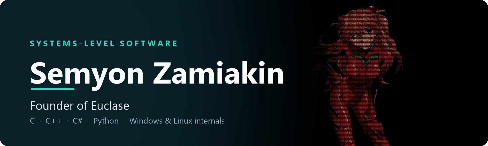
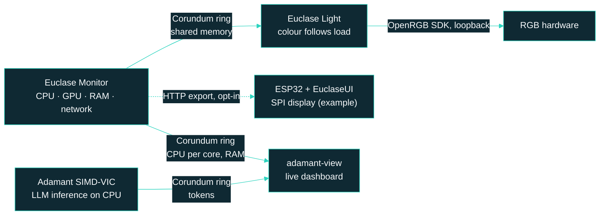

  

<h3 align="center">Semyon Zamyakin &nbsp;•&nbsp; <code>SIIMUCH</code></h3>

  <em>Founder of Euclase &nbsp;|&nbsp; Systems & Low-Level Engineer</em>

  
  
  
  
  
  
  
  

I write software that works close to the machine: an LLM engine whose SIMD kernels are written by hand, code that patches a running program's machine code, lock-free IPC
measured in nanoseconds, monitors that read the operating system directly, and UI for small embedded displays.
Everything is open source under the <b>Euclase</b> name, and every repository says plainly what is tested and what is not.

<h3 align="center">In numbers</h3>

<table align="center">
  <tr>
    <td align="center" width="20%">
      <h2>74 ns</h2>
      one-way message between two processes through <b>Corundum HFT</b> on Windows (an OS pipe: 6.7 µs)
    </td>
    <td align="center" width="20%">
      <h2>2M+</h2>
      real x86-64 instructions where <b>Vajra</b>'s own decoder matches GNU objdump
    </td>
    <td align="center" width="20%">
      <h2>1.3 ms</h2>
      per update in <b>Euclase Monitor</b> 1.1 (8.1 ms in 0.1)
    </td>
    <td align="center" width="20%">
      <h2>0</h2>
      network connections opened by <b>SessionGuard</b>: the audit log never leaves your PC
    </td>
    <td align="center" width="20%">
      <h2>38.8 tok/s</h2>
      a 1.1B-parameter LLM on an i9-9900K CPU with <b>Adamant</b>'s hand-written AVX2
    </td>
  </tr>
</table>

<h3 align="center">Projects</h3>

<table>
  <tr>
    <td colspan="2" valign="top">
      <h3><a href="https://github.com/SemyonZamiakin/Adamant">Adamant SIMD-VIC</a> &nbsp;new</h3>
      
<em>A large language model on your CPU, with every hot loop written by hand.</em>

      
Loads a quantized LLM from a GGUF file through a zero-copy memory mapping and generates text with hand-written AVX2
      kernels for the Q4_K, Q6_K and Q8_0 block formats, each bit-identical to its scalar twin: same logits, same tokens.
      Generated tokens stream to other programs over a Corundum ring; a live console view shows tokens per second and
      per-core load from Euclase Monitor.

      

        
        
        
      

      TinyLlama-1.1B: 38.8 tok/s on Windows, 45 on Linux (i9-9900K, 8 threads) · logits match an independent numpy reference (cosine 0.9998) · 3.8 M kernel results checked bit for bit · ASan + UBSan, TSan
    </td>
  </tr>
  <tr>
    <td width="50%" valign="top">
      <h3><a href="https://github.com/SemyonZamiakin/VajraBinaryCore">Vajra Binary Core</a></h3>
      
<em>Hot-patch a running C++ program without restarting it.</em>

      
Replaces machine code (entry trampolines, GOT/PLT and IAT redirection) and migrates live objects to a new struct
      layout with every pointer fixed up, all in one atomic transaction that can be reverted. Ships its own x86-64
      instruction decoder and relocator.

      

        
        
        
      

      75 tests in 11 suites · fault injection at every write · stress tests patching while 8 threads run · ASan + UBSan, TSan on the cooperative paths
    </td>
    <td width="50%" valign="top">
      <h3><a href="https://github.com/SemyonZamiakin/CorundumHFT">Corundum HFT</a></h3>
      
<em>Zero-copy IPC for high-frequency telemetry.</em>

      
A lock-free single-producer / single-consumer ring buffer in shared memory. The writer builds a message in place,
      the reader uses it in place: one acquire load and one release store per side, no system calls, locks or heap on the
      hot path. Linux (POSIX shm + futex) and Windows (named mapping + event).

      

        
        
        
      

      ~970 checks · 3 million records verified across processes · CI on Linux x86-64, arm64 and Windows with sanitizers
    </td>
  </tr>
  <tr>
    <td width="50%" valign="top">
      <h3><a href="https://github.com/SemyonZamiakin/EuclaseSessionGuard">Euclase SessionGuard</a></h3>
      
<em>Did anyone use my messengers while I was away?</em>

      
Watches Telegram, Discord, Viber, Signal, Slack and the browsers that hold your social logins: when each one ran,
      used the network and had focus, who touched its session files, logons and unlocks, and anything during your quiet
      hours. Every record is signed and chained, so edits and deletions are detected.

      

        
        
        
      

      129 tests · CI on Windows, Linux and macOS · no third-party packages · Windows file-audit mode not yet run live
    </td>
    <td width="50%" valign="top">
      <h3><a href="https://github.com/SemyonZamiakin/EuclaseMonitor">Euclase Monitor</a></h3>
      
<em>A system monitor you can reshape with one text file.</em>

      
Tray app for Windows with a skinnable overlay: CPU, GPU, RAM and network, skins in JSON with hot reload.
      Version 1.1 asks the OS only for what the skin shows, caches what never changes, and publishes every snapshot to
      other programs over a Corundum ring.

      

        
        
        
      

      ~420 KB exe · about half the CPU of 0.1 · unit tests, tested docs and end-to-end tests of the real exe
    </td>
  </tr>
  <tr>
    <td width="50%" valign="top">
      <h3><a href="https://github.com/SemyonZamiakin/EuclaseLight">Euclase Light</a></h3>
      
<em>One app for all your RGB.</em>

      
Graphics card, RAM, motherboard and anything else OpenRGB supports, with a live preview and a write-protection layer
      for memory buses. Version 1.1 lets the colours follow CPU or GPU load, read from Euclase Monitor ten times a second.

      

        
        
        
      

      68 core checks · verified on the author's PC · load-driven colour not yet tested on hardware
    </td>
    <td width="50%" valign="top">
      <h3><a href="https://github.com/SemyonZamiakin/EuclaseUI">EuclaseUI</a></h3>
      
<em>Smooth UI on cheap SPI displays.</em>

      
A dependency-free UI toolkit for ESP32 / Arduino with ST7789 and ILI9341 panels. It tracks which rectangles changed
      and sends only those over SPI, with no heap allocation.

      

        
        
        
      

      38 host checks · host simulator · not yet verified on real hardware
    </td>
  </tr>
</table>

<h3 align="center">How they fit together</h3>

<h3 align="center">Engineering approach</h3>

<table>
  <tr>
    <td width="50%" valign="top">
      <b>Tested, and honest about it</b> 
      Every repository has automated tests and CI, and a README section on what is verified and what is not, including the parts that could not be run on real hardware.
    </td>
    <td width="50%" valign="top">
      <b>Verified against references</b> 
      Differential testing where it matters (Vajra's decoder against GNU objdump), fault injection at every write, multi-threaded stress tests, ASan / UBSan and TSan where they apply.
    </td>
  </tr>
  <tr>
    <td width="50%" valign="top">
      <b>Measured, not guessed</b> 
      Benchmarks name the machine, the build and the method, compare against the obvious alternative, and say when a result is noisy.
    </td>
    <td width="50%" valign="top">
      <b>Private by default</b> 
      Tools that watch the machine never send data off it, network services listen on loopback unless told otherwise, downloads are pinned and checksummed, no secrets in repositories.
    </td>
  </tr>
</table>

<h3 align="center">Contact</h3>

  
  
  

  Open to technical co-founder / CTO roles in high-performance and systems-level product teams.

